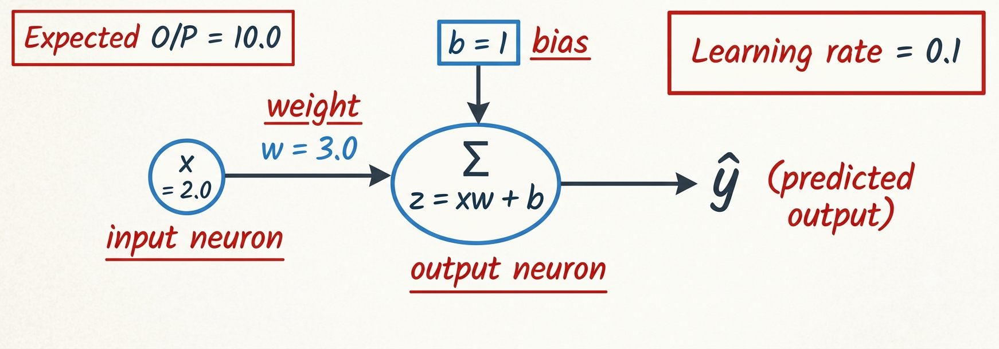

# simplest-supervised-neural-network

A bare-bones single-neuron perceptron in pure Python. It uses a forward pass linear equation, the manual calculus chain rule, and gradient descent to iteratively adjust the weight and bias until the network's prediction error approaches zero, demonstrating how a model learns from scratch.

---

## 📐 Network Architecture

<!-- REPLACE THE LINE BELOW WITH YOUR ACTUAL IMAGE LINK AFTER UPLOADING TO GITHUB -->


This project simulates a **single-neuron perceptron** (the simplest unit of a neural network). It consists of:

* **Input ($x = 2.0$):** The feature processed by the network.
* **Weight ($w$):** The adjustable slope parameter, initialized at `3.0`.
* **Bias ($b$):** The adjustable offset parameter, initialized at `1.0`.
* **Output ($\hat{y}$):** The prediction node, calculated as $\hat{y} = xw + b$.
* **Target ($y = 10.0$):** The ground-truth correct answer.

---

## 🧠 How It Works (The 3 Phases)

The script runs a training loop for 40 iterations. Every iteration goes through three distinct mathematical phases.

### Phase 1: The Forward Pass

The network makes a guess ($\hat{y}$) and measures how far off it is using a half Mean Squared Error:

$$
\hat{y} = x \cdot w + b
$$

$$
E = \frac{1}{2}(\hat{y} - y)^2
$$

### Phase 2: The Manual Calculus Chain Rule

Instead of using automatic differentiation libraries, the code calculates exactly how the error $E$ changes with respect to $w$ and $b$ using the chain rule.

**Output error dependency:**

$$
\frac{\partial E}{\partial \hat{y}} = \hat{y} - y
$$

**Weight gradient:**

$$
\frac{\partial E}{\partial w} = \frac{\partial E}{\partial \hat{y}} \cdot \frac{\partial \hat{y}}{\partial w} = (\hat{y} - y) \cdot x
$$

**Bias gradient:**

$$
\frac{\partial E}{\partial b} = \frac{\partial E}{\partial \hat{y}} \cdot \frac{\partial \hat{y}}{\partial b} = (\hat{y} - y) \cdot 1
$$

### Phase 3: Gradient Descent Update

The network adjusts the weight and bias by subtracting a fraction of the gradients, scaled by the `learning_rate` ($\eta = 0.1$):

$$
w \leftarrow w - \eta \cdot \frac{\partial E}{\partial w}
$$

$$
b \leftarrow b - \eta \cdot \frac{\partial E}{\partial b}
$$

---

## 🔢 Worked Example (First Iteration)

Starting with $x = 2$, $w = 3$, $b = 1$, $y = 10$:

| Step | Calculation | Result |
|------|-------------|--------|
| Prediction | $\hat{y} = 2 \cdot 3 + 1$ | $7$ |
| Error | $E = \frac{1}{2}(7 - 10)^2$ | $4.5$ |
| Output gradient | $\hat{y} - y = 7 - 10$ | $-3$ |
| Weight gradient | $-3 \cdot 2$ | $-6$ |
| Bias gradient | $-3 \cdot 1$ | $-3$ |
| New weight | $3 - 0.1 \cdot (-6)$ | $3.6$ |
| New bias | $1 - 0.1 \cdot (-3)$ | $1.3$ |

The next prediction is $2 \cdot 3.6 + 1.3 = 8.5$, which is closer to the target of $10$. With these settings the prediction gap halves every iteration, so after 40 iterations the error is effectively zero, and the parameters settle at roughly $w = 4.2$ and $b = 1.6$ (check: $2 \cdot 4.2 + 1.6 = 10$).

---

## 🚀 Getting Started

### Prerequisites

* **Python 3.x** (the script uses only the standard library and has **zero external dependencies**).

### Installation & Execution

1. Clone the repository:

   ```bash
   git clone https://github.com/Naradhrishi/simplest-supervised-neural-network.git
   cd simplest-supervised-neural-network
   ```

2. Run the script:

   ```bash
   python main.py
   ```

---

## 📄 License

This project is licensed under the [MIT License](LICENSE).